스코프 시작전 확인
---
접지, probe comp연결 후 평균 2.5V의 사각펄스파가 제대로 나오는지 본다.<br>
모양이 제대로 안 나올시 probe의 구멍을 통해 가변 C, R값 변경<br>
트리거로 확인하는 법- trigger menu누른 후 원하는 것들 선택<br>
  유형은 파형 모양<br>
  신호원(확인하는 채널)>br>
  경사(하강, 상승)<br>
  모드(자동시 그냥 흐름, 보통시 원하는 거 올시 정지)<br>
  커플링 (Dc는 dc, ac모두 통과, AC는 dc차단, gnd는 모두 차단)


스코프 실험(LD2 PA5번핀)
---

```C
  /* Infinite loop */
  /* USER CODE BEGIN WHILE */
  while (1)
  {
	  counter++;
	  HAL_GPIO_TogglePin(LD2_GPIO_Port, LD2_Pin);
	  HAL_Delay(500);
    /* USER CODE END WHILE */
```

f4111보드에서 Gnd와 SCK/D13핀(위에서 5번째)을 프로브와 연결<br>
디버깅 후 HAL_DELAY줄에서 trigger에서 에지, 보통으로 한 후 상승, 하강 찍음<br>
코드는 토글, delay순서로 되어있었음<br>
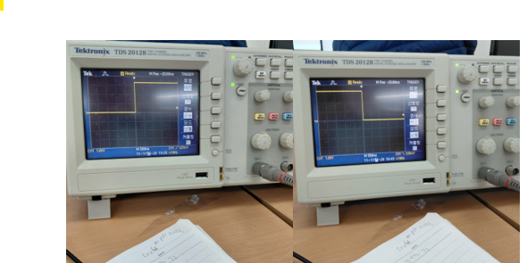<br>


cpu와 주변 장치 연결
-----
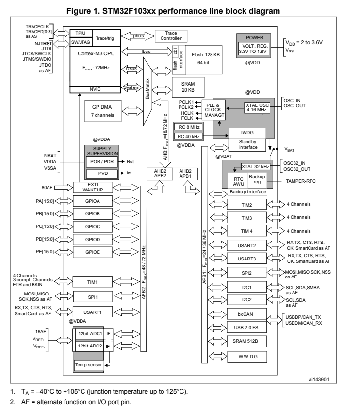<br>
cpu의 64비트를 연결된 장치에 보냄. 그중 앞의 address비트 32비트로 장치를 지정된 것만 해당 비트의 뒤의 데이터 비트를 처리해주고 나머지는 무시해줌<br>
참고로 portA는 0x4002_0000의 위치임<br>


port에 연결된 것들 핀 설정 방법
---
offset으로 adress부분 4씩 띄워져있음.(cpu의 앞 32자리)

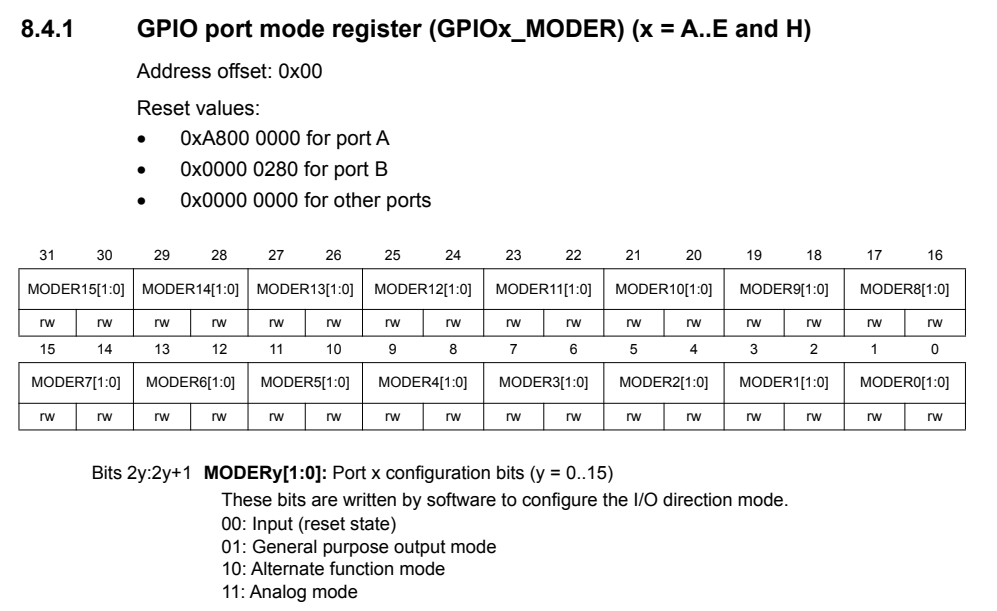<br>
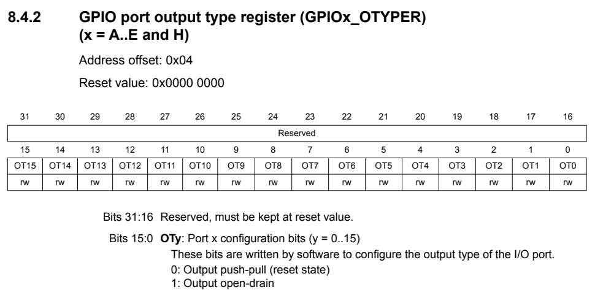<br>
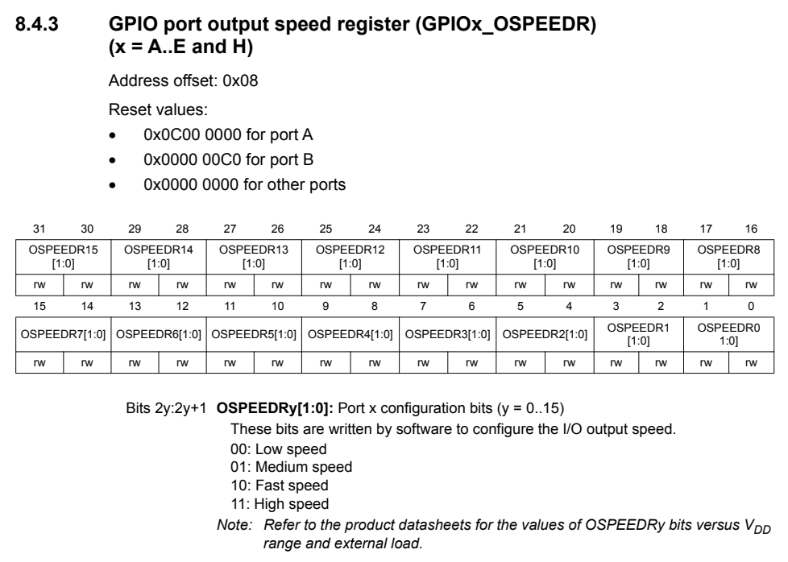<br>
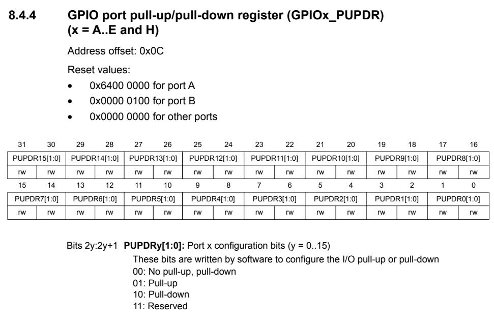<br>
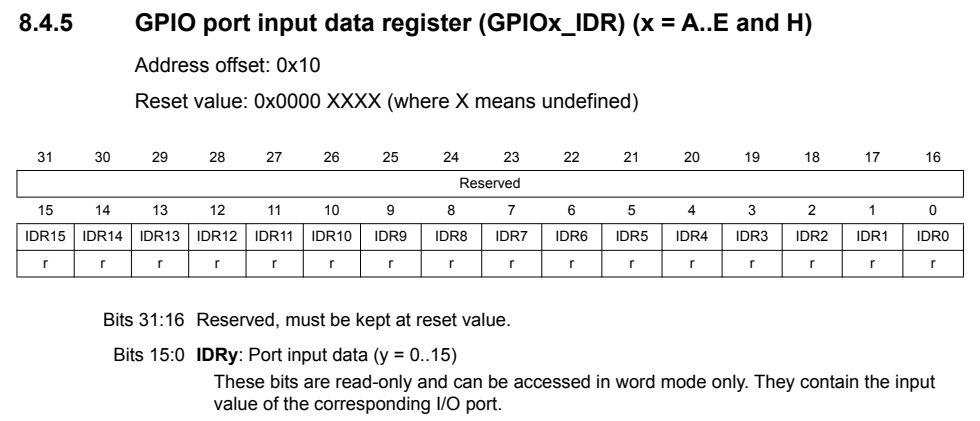<br>
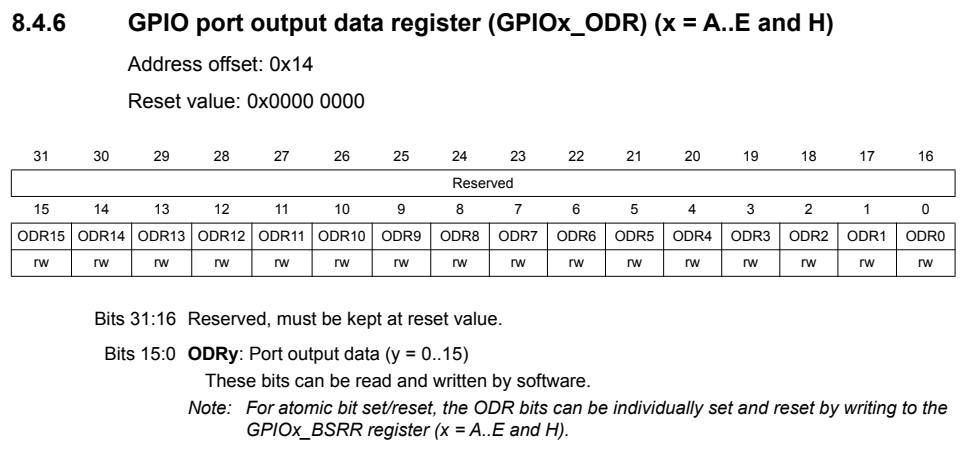<br>
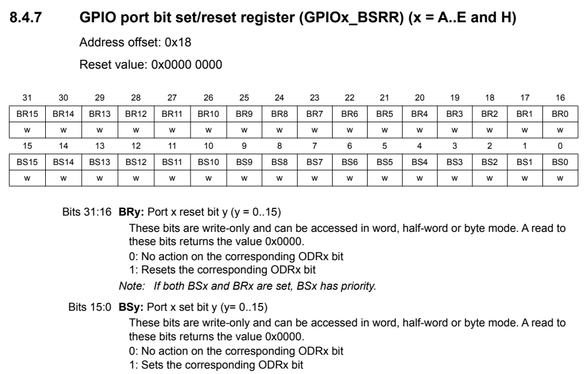<br>

주의할 점으로는 비트 순서가 각각 자기 맘대로이니 한개만 외우고 하지 말 것.<br>
예를 들어서, MODER는 앞에서부터 2비트씩 핀 1개 지정인데, 출력지정하는 ODR은 뒤의 15-0비트만 쓰고, 특정 출력핀 변경인 BSRR은 ODR에 맞춰서 앞 31-16비트가 0(reset)으로 만들고, 뒤의 15-0비트로 1(set)로 바꿀 것을 1로 지정<br>


IDE의 디버그 창에서 PA6번 껏다가 켜기
---
MODER는 켜기/끄기이니 해당 핀을 01로 OUTPUT모드
```
  0b0000_0000_0000_0000_0001_0000_0000_0000
   =0x0000_1000
```
ODR은 앞 16비트 상관 안쓰니 그냥 0으로 채우고, 

6번핀이니 뒷자리 
```
  0b0000_0000_0000_0000_0000_0000_0100_0000
   =0x0000_0040
```

0b0100_0000=0x40과 0b0000_0000으로 바꾸면서 하면 됨.
BSRR바꿀거면 ODR냅두고  0x40으로 켜고(set), 0x4000으로 끄기(reset)

표만들기(table)
| 열1 | 열2 | 열3 | 열4 |
|-----|-----|-----|-----|
|켠 순간| 끈 순간 |on 디버그창|off 디버그창|
| 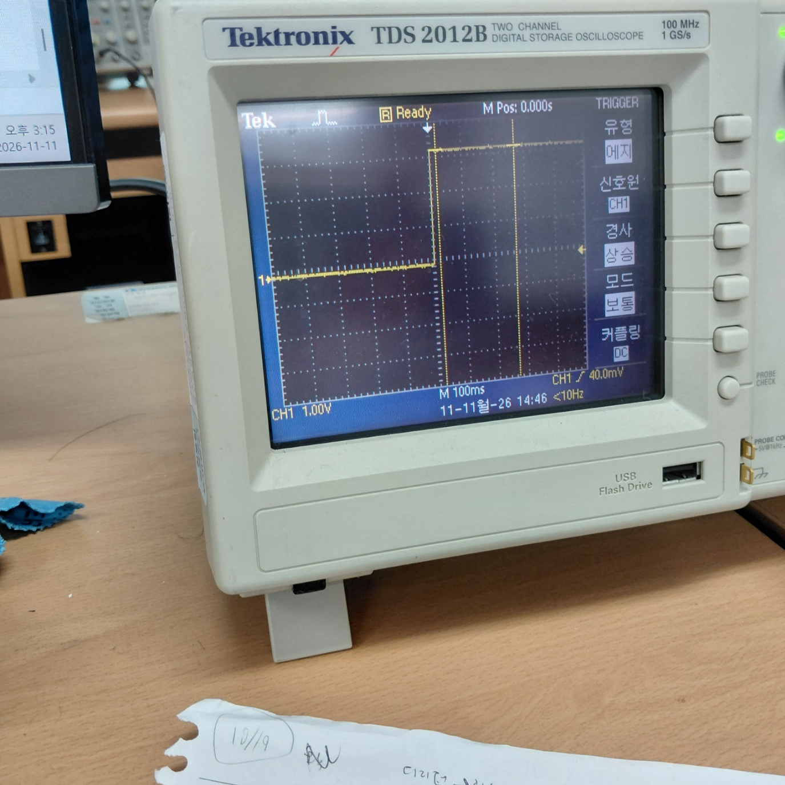 | 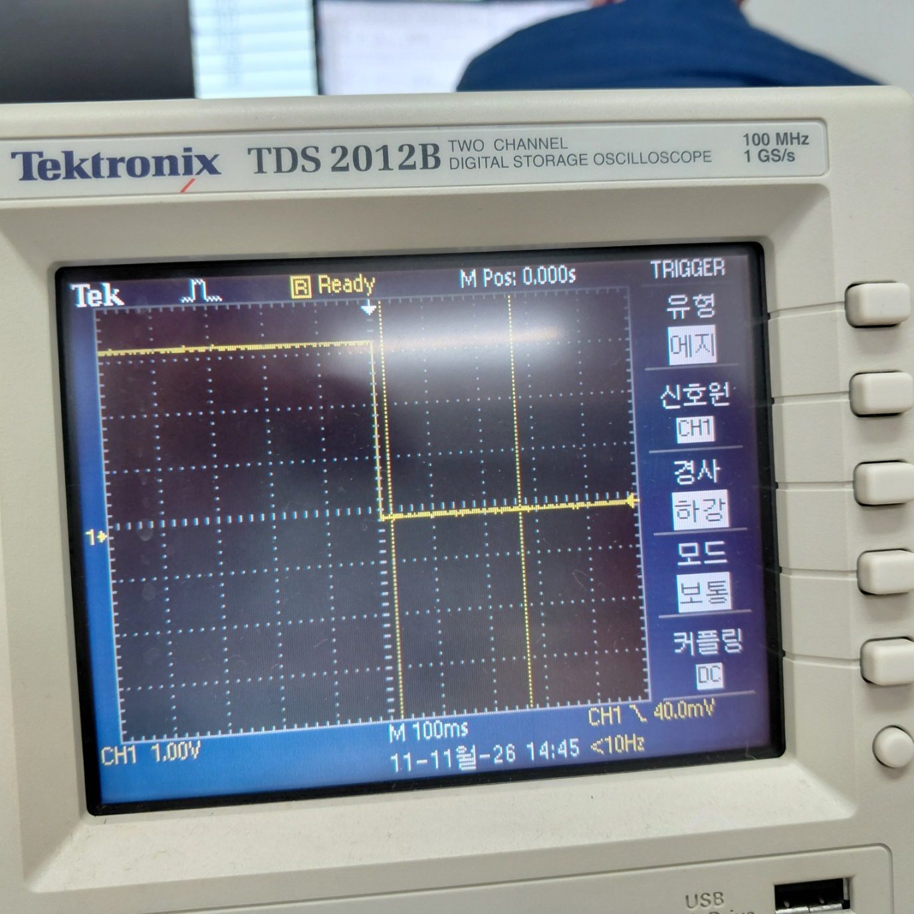 |<p align="center">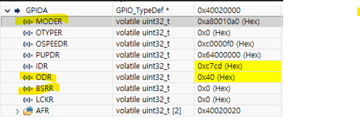
</p> | |


