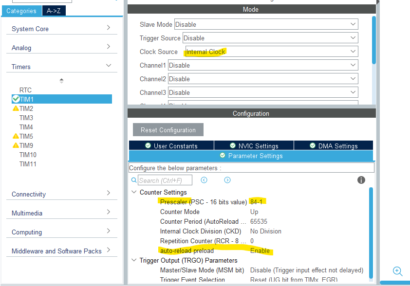
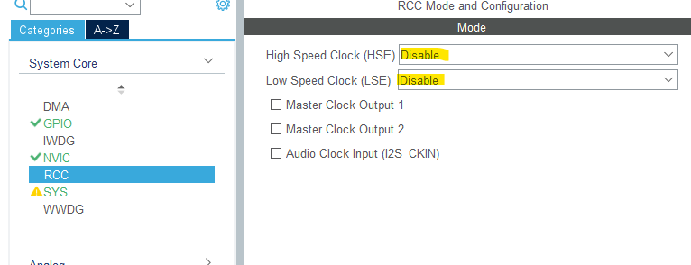
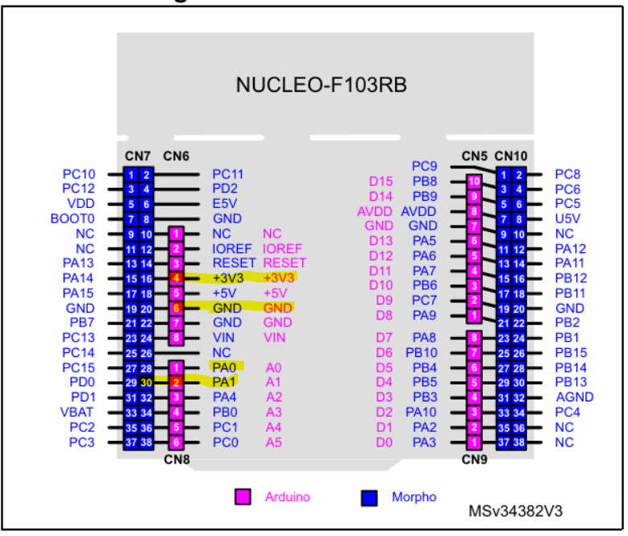
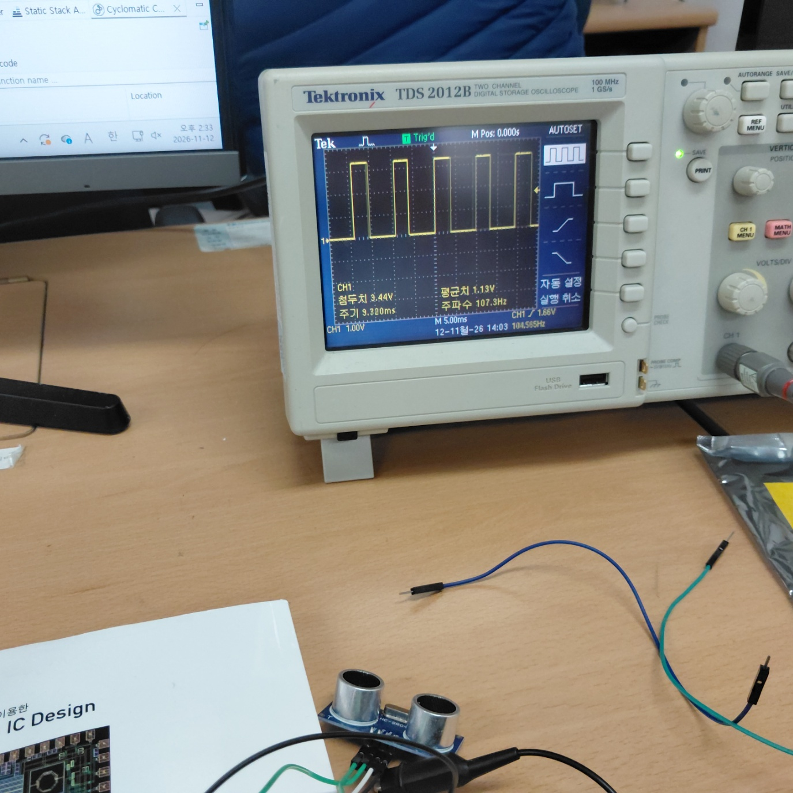
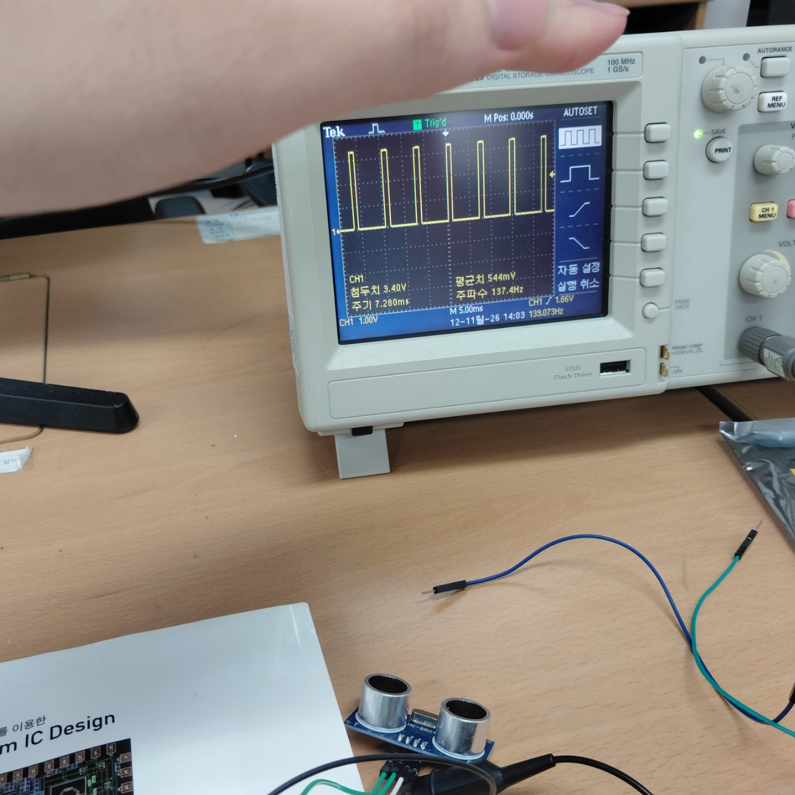
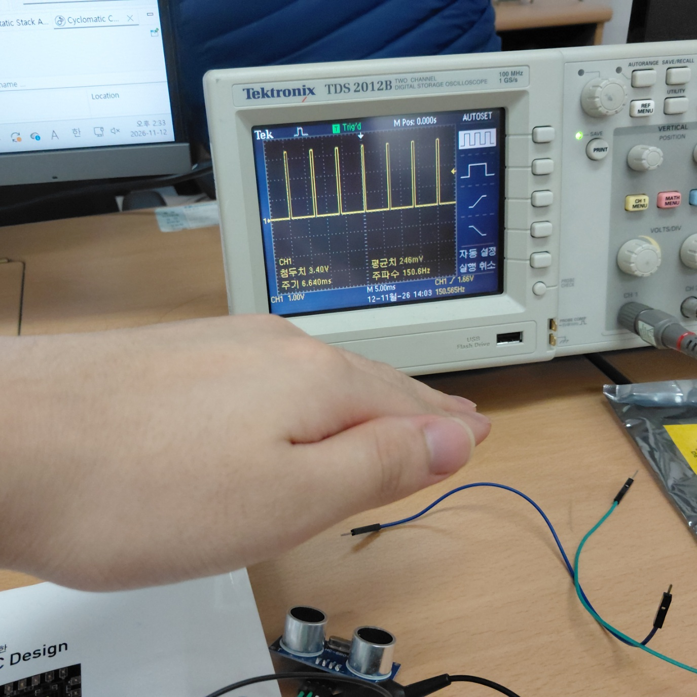
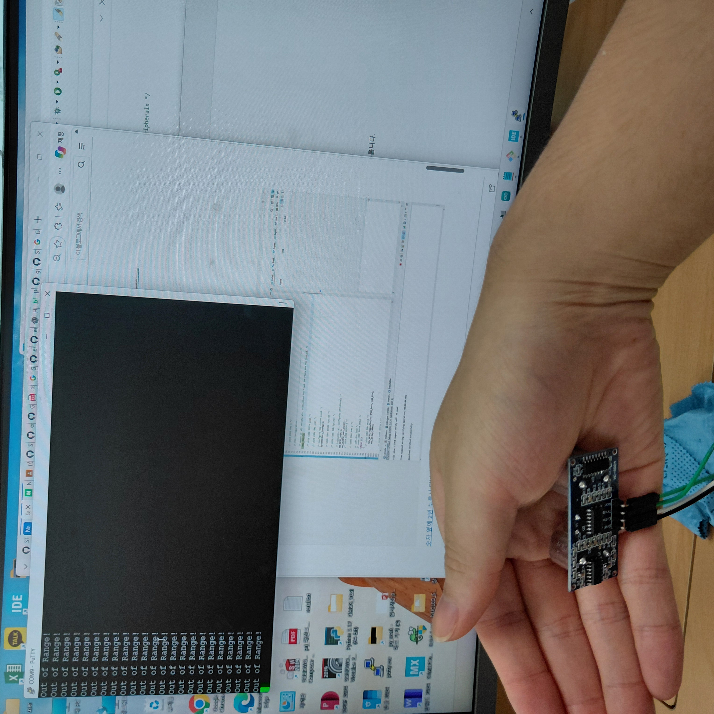
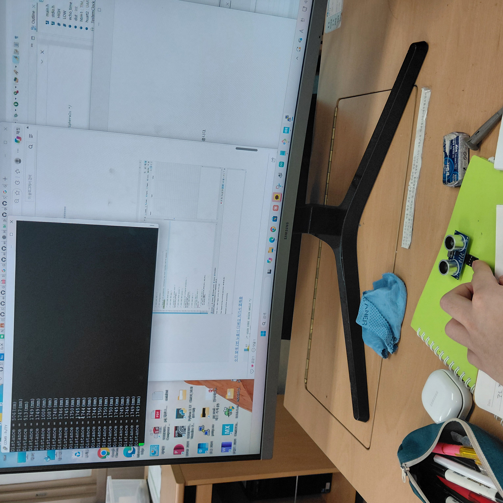
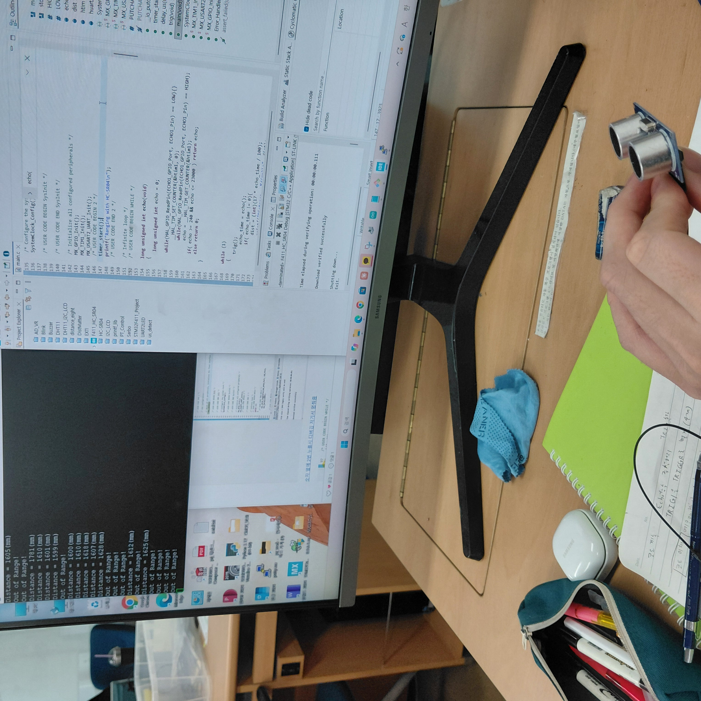

#HC_SR04초음파 센서 써보기


HC_SR04동작을 크게 보면 3가지<br>
---
1. triger로 10us의 파형이 들어감
2.  40k Hz의 신호 전송 후 받음
3. Echo에서 전송, 송신 사이의 시간만큼의 파형 보냄.
<br>


연결


트리거 핀만 먼저 할 것임.


10us클럭을 만들기 위한 내부 클럭을 1us(주기1MHz)로 변경하기<br>
---
F411의 클럭 주기인 84M Hz 에 prescaler로 84로 나눠서 하면 됨. 이때, 0~n-1으로 세는 것이므로 84-1이라 한것. 83 적어도 됨.<br>
auto-reload-preload를 enable로 만들어줌. 이유는 카운트의 최대값이 중간에 바뀌어서 측정값이 달라지지 않게 하기 위함.<br>




delay문을 타이머로 만들어서 쓰는 이유
---
HAL_Delay()문의 경우 틱으로 하는 거라 작은 시간 1ms나 2ms를 하면 아래의 사진들과 같이 딜레이가 변조될 우려가 있음.<br>
1ms줄 경우 <br>
_result.jpg) <br>
2ms 줄 경우 <br>
_result.jpg)<br>
타이머로 제대로 delay_us란 이름으로 만든 것(200us)<br>
_result.jpg)


echo까지 다 연결 후 코드 완성
---
스코프와 연결<br>

거리별(triger 200us기준)<br>
|long|middle|short|
|----|----|----|
| | ||


참고
---
내부 회로의 40k Hz의 펄스 8개 사진


결과
---
|이하 |사이|초과|
|---|---|---|
||||


코드
---
여기의 코드에서 trigger 확인할 때에 <br>
while문 내에 trig();와 delay문들만 썼음<br>
원문에서는 delay가 없으나, 안 쓰면 

```c
/* Includes ------------------------------------------------------------------*/
#include "main.h"

/* Private includes ----------------------------------------------------------*/
/* USER CODE BEGIN Includes */
#include <stdio.h>
/* USER CODE END Includes */
```
'''c
/* USER CODE BEGIN PD */
#define HIGH 1
#define LOW 0
long unsigned int echo_time;
int dist;
/* USER CODE END PD */
```
```c
/* USER CODE BEGIN 0 */
#ifdef __GNUC__
/* With GCC, small printf (option LD Linker->Libraries->Small printf
   set to 'Yes') calls __io_putchar() */
#define PUTCHAR_PROTOTYPE int __io_putchar(int ch)
#else
#define PUTCHAR_PROTOTYPE int fputc(int ch, FILE *f)
#endif /* __GNUC__ */

/**
  * @brief  Retargets the C library printf function to the USART.
  * @param  None
  * @retval None
  */
PUTCHAR_PROTOTYPE
{
  /* Place your implementation of fputc here */
  /* e.g. write a character to the USART1 and Loop until the end of transmission */
  if (ch == '\n')
    HAL_UART_Transmit (&huart2, (uint8_t*) "\r", 1, 0xFFFF);
  HAL_UART_Transmit (&huart2, (uint8_t*) &ch, 1, 0xFFFF);

  return ch;
}

void timer_start(void)
{
   HAL_TIM_Base_Start(&htim1);
}

void delay_us(uint16_t us)
{
   __HAL_TIM_SET_COUNTER(&htim1, 0); // initislize counter to start from 0
   while((__HAL_TIM_GET_COUNTER(&htim1))<us); // wait count until us
}

void trig(void)
{
   HAL_GPIO_WritePin(TRIG1_GPIO_Port, TRIG1_Pin, HIGH);
   delay_us(10);
   HAL_GPIO_WritePin(TRIG1_GPIO_Port, TRIG1_Pin, LOW);
}

/**
* @brief echo 신호가 HIGH를 유지하는 시간을 (㎲)단위로 측정하여 리턴한다.
* @param no param(void)
*/
long unsigned int echo(void)
{
   long unsigned int echo = 0;

   while(HAL_GPIO_ReadPin(ECHO1_GPIO_Port, ECHO1_Pin) == LOW){}
        __HAL_TIM_SET_COUNTER(&htim1, 0);
        while(HAL_GPIO_ReadPin(ECHO1_GPIO_Port, ECHO1_Pin) == HIGH);
        echo = __HAL_TIM_GET_COUNTER(&htim1);
   if( echo >= 240 && echo <= 23000 ) return echo;
   else return 0;
}
/* USER CODE END 0 */
```


```c
  /* USER CODE BEGIN 2 */
  timer_start();
  printf("Ranging with HC-SR04\n");
  /* USER CODE END 2 */

  /* Infinite loop */
  /* USER CODE BEGIN WHILE */
  while (1)
  {
	  trig();
	      echo_time = echo();
	      if( echo_time != 0){
	          dist = (int)(17 * echo_time / 100); #거리mm단위 측정. 340 * echo_time(us) /2000 = 0.17*exho_time / 100
	          printf("Distance = %d(mm)\n", dist);
	      }
	      else printf("Out of Range!\n");
    HAL_Delay(200);
    /* USER CODE END WHILE */

    /* USER CODE BEGIN 3 */
  }
```
