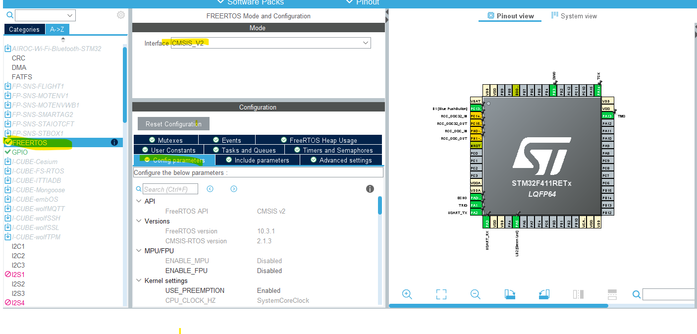
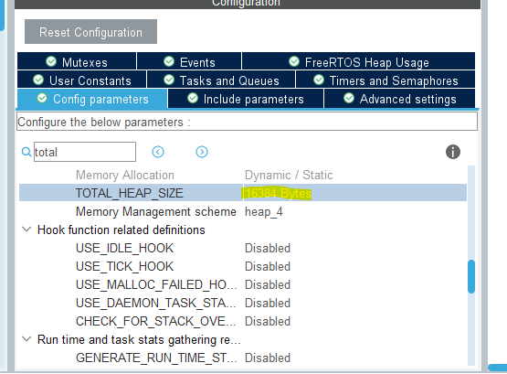
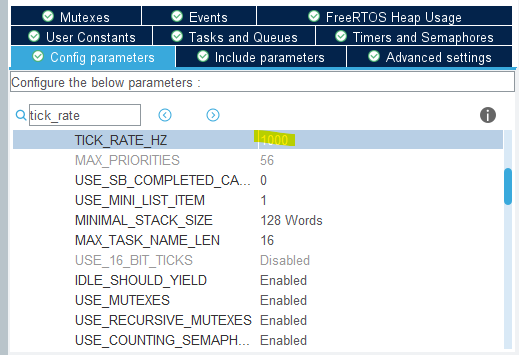
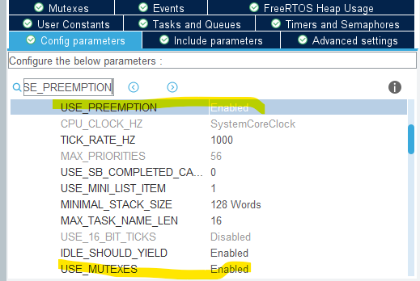
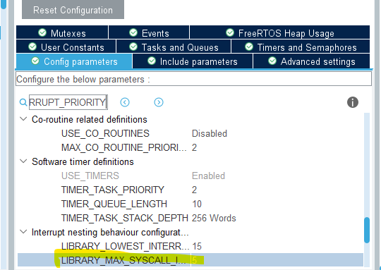
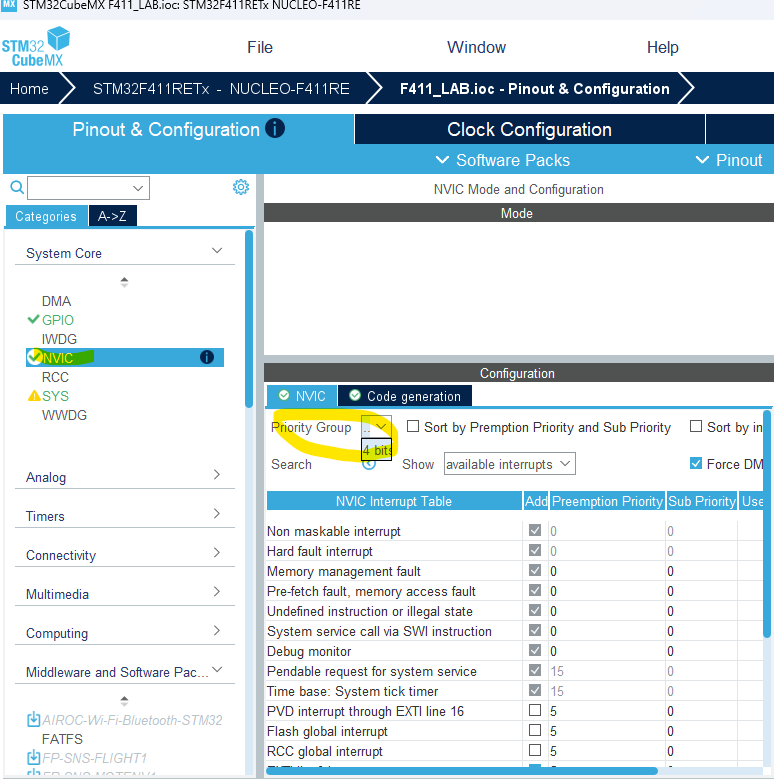
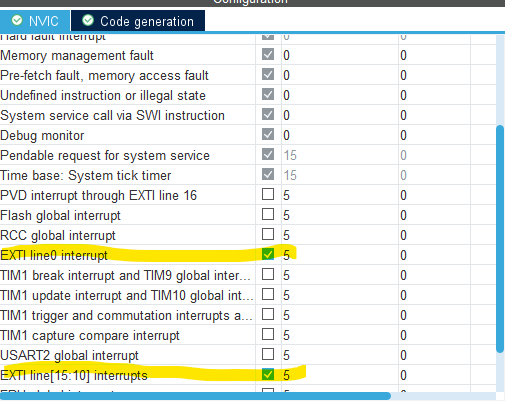

1. FreeRTOS
---

장점 자동으로 조정 잘해줌<br>
단점 비용, 메모리 스펙 등을 잘 못맞춰줘서 처음부터 다시 할 수도 있음<br>

# (1.2)CubeMX에서의 설정


## 1.2.1Middleware / NVIC / Clock
위의 것들은 
| 항목 | 최종 값 | 비고 |
|---|---|---|
| FREERTOS Interface | `CMSIS_V2` | `VP_FREERTOS_VS_CMSIS_V2.Mode=CMSIS_V2` |
| `configTOTAL_HEAP_SIZE` | `16384` | 태스크 3개 + 대기 여유 확보 |
| `configTICK_RATE_HZ` | 1000 | 1 ms tick |
| `configUSE_PREEMPTION` | enabled | 선점형 스케줄링 |
| `configUSE_MUTEXES` | enabled | `myMutex01` 사용 |
| `configLIBRARY_MAX_SYSCALL_INTERRUPT_PRIORITY` | 5 | EXTI 우선순위 5와 매칭 |
| NVIC Priority Group | `NVIC_PRIORITYGROUP_4` | "4 bits for pre-emption priority" |
| EXTI0 / EXTI15_10 우선순위 | 5 | `HAL_NVIC_SetPriority(..., 5, 0)` 생성됨 |
| SYS Timebase Source | **SysTick 유지** | 아래 참고 참고 |

순서대로 사진으로 표기<br>
<br>
<br>
<br>
<br>
<br>
<br>
<br>


2. MNIST 에 대한 PC에서의 모델한 비교(Keras, TFLite F32, TFLite Int8)
---

2.1 ai학습된거 사진 준비
---
이미지 준비 순서(1. 개요 2. 실습1:PC에서 MNIST숫자 인식 모델 학습)
(1)아나콘다 프롬프트 열기<br>
(2)pip install tensorflow numpy matplotlib pillow로 필요 라이브러리 설치<br>
(3)edit mnist_pc_train.py로 mnist_pc_train.py파일 생성하면 자동으로 열림. 아래의 코드 복사 후 ctrl+s저장 후 q로 나감.<br>
(4)python mnist_pc_train.py로 실행하면 모델 model.h5파일 저장함 <--정확한 이름은 mnist_pc_model.h5 .<br>
    여기서 사진 받고 flatten으로 1계층 784로 바꾸고, 은닉층(dense)로 128, 64, 10으로 하고 만듬 (1~10이미지라 그렇게 한듯?)<br>
	C:\Users\user\.keras\datasets에 mnist.npz파일 만들어진거면 성공(6만개정도 있는거)<br>
(5) cd C:\Users\user\.keras\datasets로 해당파일로 이동<br>
(6) 이미지 파일 확인하기<br>edit unzip.py로 .py만들고 코드 복사 후 저장, 나가기<br>
(7) pyhon edit unzip.py로 실행하면 파일이 만들어짐. 경로는 C:\Users\user\Desktop\MNIST_Images (바탕화면에 MNIST_Images폴더)<br>
   그 폴더 내부에 test(테스트용)와 train(학습용 폴더) 만들어짐<br>

<details>
<summary>mnist_pc_train.py</summary>

  ```c
# mnist_pc_train.py
# PC에서 MNIST 숫자 인식 모델 학습 (float32)

import tensorflow as tf
from tensorflow import keras
import numpy as np
import time
import os

# 1. MNIST 데이터 로드
print("[1/5] MNIST 데이터 로드 중...")
(x_train, y_train), (x_test, y_test) = keras.datasets.mnist.load_data()

# 정규화 (0~255 → 0~1)
x_train = x_train.astype(np.float32) / 255.0
x_test = x_test.astype(np.float32) / 255.0

# shape 확인
print(f"  학습 데이터: {x_train.shape}, 레이블: {y_train.shape}")
print(f"  테스트 데이터: {x_test.shape}, 레이블: {y_test.shape}")
print(f"  픽셀 범위: [{x_train.min()}, {x_train.max()}]")

# 2. 모델 정의
print("\n[2/5] 모델 정의 중...")
model = keras.Sequential([
    # 입력: 28x28 1채널 (Grayscale)
    keras.layers.InputLayer(input_shape=(28, 28, 1)),

    # Flatten: 28x28 → 784
    keras.layers.Flatten(),

    # 은닉층 1: 128 뉴런, ReLU 활성화
    keras.layers.Dense(128, activation='relu'),

    # 은닉층 2: 64 뉴런, ReLU 활성화
    keras.layers.Dense(64, activation='relu'),

    # 출력층: 10 뉴런 (0~9), Softmax
    keras.layers.Dense(10, activation='softmax')
])

model.summary()

# 3. 모델 컴파일
print("\n[3/5] 모델 컴파일 중...")
model.compile(
    optimizer='adam',
    loss='sparse_categorical_crossentropy',
    metrics=['accuracy']
)

# 4. 모델 학습
print("\n[4/5] 모델 학습 시작...")

# EarlyStopping: 검증 손실이 3번 연속 개선 없으면 중단
callbacks = [
    keras.callbacks.EarlyStopping(patience=3, restore_best_weights=True)
]

start_time = time.time()
history = model.fit(
    x_train, y_train,
    batch_size=64,
    epochs=20,
    validation_split=0.2,  # 학습 중 20%를 검증용으로 분할
    callbacks=callbacks,
    verbose=2
)
train_time = time.time() - start_time

print(f"\n✅ 학습 완료! 소요 시간: {train_time:.2f}초")

# 5. 모델 평가
print("\n[5/5] 테스트 세트 평가 중...")
test_loss, test_acc = model.evaluate(x_test, y_test, verbose=0)
print(f"\n📊 PC 모델 (float32) 테스트 정확도: {test_acc:.4f} ({test_acc * 100:.2f}%)")
print(f"   테스트 손실: {test_loss:.4f}")

# 6. 모델 저장
model.save('mnist_pc_model.h5')
print("\n💾 모델 저장 완료: mnist_pc_model.h5")
```


</details>

<details>
<summary><unzip.py></summary>
```c
# unzip.py
import os
import numpy as np
from PIL import Image

# mnist.npz 위치
npz_path = r"C:\Users\user\.keras\datasets\mnist.npz"

# 저장할 폴더
output_dir = r"C:\Users\user\Desktop\MNIST_Images"

# 데이터 읽기
data = np.load(npz_path)

x_train = data["x_train"]
y_train = data["y_train"]

x_test = data["x_test"]
y_test = data["y_test"]


def save_dataset(images, labels, dataset_name):
    base = os.path.join(output_dir, dataset_name)

    # 숫자별 폴더 생성
    for i in range(10):
        os.makedirs(os.path.join(base, str(i)), exist_ok=True)

    # 이미지 저장
    for idx, (img, label) in enumerate(zip(images, labels)):
        filename = os.path.join(
            base,
            str(label),
            f"{idx:06d}.png"
        )

        Image.fromarray(img).save(filename)

    print(f"{dataset_name} 저장 완료 ({len(images)}장)")


save_dataset(x_train, y_train, "train")
save_dataset(x_test, y_test, "test")

print("모든 이미지 저장 완료!")
print("저장 위치:", output_dir)
```
</details>


2.2 TFLite 변환 및 양자화
---
목표: 2까지 했을때 만들어진건 float32라 이걸 int8양자화까지 해서 파일 2개 만들것<br>
(1)위치는 users/user이동후 edit mnist_to_tflite.py후 3.2의 코드 저장 후 실행<br>


<details>
<summary><mnist_to_tflite.py코드></summary>

```c
# mnist_to_tflite.py
# PC 모델 → TFLite 변환 및 양자화

import tensorflow as tf
import numpy as np
import os

# 1. 저장된 PC 모델 로드
print("[1/6] PC 모델 로드 중...")
model = tf.keras.models.load_model('mnist_pc_model.h5')
print(f"  로드 완료: mnist_pc_model.h5")

# 2. MNIST 테스트 데이터 로드 (양자화 Calibration용)
print("\n[2/6] Calibration 데이터 로드 중...")
(_, _), (x_test, y_test) = tf.keras.datasets.mnist.load_data()
x_test = x_test.astype(np.float32) / 255.0

# 대표 데이터셋 (100장만 사용)
calibration_data = x_test[:100]
print(f"  Calibration 데이터: {calibration_data.shape}")

# 3. Float32 TFLite 변환 (양자화 없음)
print("\n[3/6] Float32 TFLite 변환 중...")
converter_float = tf.lite.TFLiteConverter.from_keras_model(model)
tflite_float_model = converter_float.convert()

float_path = 'mnist_float32.tflite'
with open(float_path, 'wb') as f:
    f.write(tflite_float_model)
float_size = os.path.getsize(float_path)
print(f"  ✅ Float32 TFLite 저장 완료: {float_path}")
print(f"     크기: {float_size:,} bytes ({float_size/1024:.1f} KB)")

# 4. Int8 양자화 TFLite 변환 (MCU용)
print("\n[4/6] Int8 양자화 TFLite 변환 중...")

def representative_dataset():
    """Calibration용 대표 데이터셋: 100장"""
    for i in range(100):
        # Shape: (1, 28, 28, 1)
        x = calibration_data[i].reshape(1, 28, 28, 1)
        yield [x.astype(np.float32)]

converter_int8 = tf.lite.TFLiteConverter.from_keras_model(model)
converter_int8.optimizations = [tf.lite.Optimize.DEFAULT]
converter_int8.representative_dataset = representative_dataset
# int8 연산으로 강제 지정 (일부 연산이 float32로 남는 것 방지)
converter_int8.target_spec.supported_ops = [tf.lite.OpsSet.TFLITE_BUILTINS_INT8]
# 입력/출력 타입을 int8로
converter_int8.inference_input_type = tf.int8
converter_int8.inference_output_type = tf.int8

tflite_int8_model = converter_int8.convert()

int8_path = 'mnist_int8_quantized.tflite'
with open(int8_path, 'wb') as f:
    f.write(tflite_int8_model)
int8_size = os.path.getsize(int8_path)
print(f"  ✅ Int8 양자화 TFLite 저장 완료: {int8_path}")
print(f"     크기: {int8_size:,} bytes ({int8_size/1024:.1f} KB)")

# 5. 크기 비교
print("\n[5/6] 모델 크기 비교")
reduction = (1 - int8_size / float_size) * 100
print(f"  Float32 모델: {float_size:>8,} bytes ({float_size/1024:.1f} KB)")
print(f"  Int8 양자화 모델: {int8_size:>8,} bytes ({int8_size/1024:.1f} KB)")
print(f"  📉 크기 감소율: {reduction:.1f}%")

# 6. 모델 정보 출력
print("\n[6/6] 모델 상세 정보")
# Float32 모델
interpreter_float = tf.lite.Interpreter(model_content=tflite_float_model)
interpreter_float.allocate_tensors()
float_details = interpreter_float.get_input_details()[0]

print(f"\n  [Float32 모델]")
print(f"    입력 shape: {float_details['shape']}")
print(f"    입력 dtype: {float_details['dtype']}")

# Int8 모델
interpreter_int8 = tf.lite.Interpreter(model_content=tflite_int8_model)
interpreter_int8.allocate_tensors()
int8_details = interpreter_int8.get_input_details()[0]

print(f"\n  [Int8 양자화 모델]")
print(f"    입력 shape: {int8_details['shape']}")
print(f"    입력 dtype: {int8_details['dtype']}")
print(f"    입력 scale: {int8_details['quantization_parameters']['scales']}")
print(f"    입력 zero_point: {int8_details['quantization_parameters']['zero_points']}")

print(f"\n{'='*50}")
print(f"✨ Int8 양자화 모델이 MCU(ESP32)에 탑재 가능한 크기로 줄었습니다!")
print(f"{'='*50}")
```

</details>


3.3PC에서 TFLite 모델 추론 및 검증
---
목표<br>
(1)변환된 TFLite 모델(Float32, Int8)로 실제 추론 실행<br>
(2)각 모델의 정확도 측정<br>
(3)각 모델의 추론 시간 측정<br>

실행<br>
(1)Float32와 Int8 양자화 비교<br>
 (base) C:\Users\user>로 두고 edit mnist_tflite_eval.py로 만들고 4.2코드 복사 후 저장, python <br>mnist_tflite_eval.py로 실행<br>
(2)시각화: PC 모델 vs TFLite 모델 결과 비교<br>
edit visualize_all_results.py후 4.4의 코드 복사 후 실행하면 결과로 사진 4개가 나옴.<br>
 위치는 Users/user에 viz로 시작하는 사진 4개<br>

<details>
<summary><mnist_tflite_eval.py코드></summary>
```c
# mnist_tflite_eval.py
# TFLite 모델 (Float32 vs Int8) 추론 및 정확도/속도 비교

import tensorflow as tf
import numpy as np
import time

# 1. MNIST 테스트 데이터 로드
print("[1/7] MNIST 테스트 데이터 로드 중...")
(_, _), (x_test, y_test) = tf.keras.datasets.mnist.load_data()
x_test_float = x_test.astype(np.float32) / 255.0  # [0, 1]
print(f"  테스트 데이터: {x_test.shape}")

# 2. TFLite 모델 로드
print("\n[2/7] TFLite 모델 로드 중...")

# Float32 모델
interpreter_float = tf.lite.Interpreter(model_path='mnist_float32.tflite')
interpreter_float.allocate_tensors()
input_float = interpreter_float.get_input_details()[0]
output_float = interpreter_float.get_output_details()[0]
print(f"  Float32 모델 로드 완료")
print(f"    입력: {input_float['shape']}, {input_float['dtype']}")
print(f"    출력: {output_float['shape']}, {output_float['dtype']}")

# Int8 모델
interpreter_int8 = tf.lite.Interpreter(model_path='mnist_int8_quantized.tflite')
interpreter_int8.allocate_tensors()
input_int8 = interpreter_int8.get_input_details()[0]
output_int8 = interpreter_int8.get_output_details()[0]
print(f"  Int8 양자화 모델 로드 완료")
print(f"    입력: {input_int8['shape']}, {input_int8['dtype']}")
print(f"    출력: {output_int8['shape']}, {output_int8['dtype']}")

# 3. Float32 모델 추론
print("\n[3/7] Float32 모델 추론 중...")

correct_float = 0
times_float = []

for i in range(len(x_test)):
    # 입력 전처리
    input_data = x_test_float[i].reshape(1, 28, 28, 1).astype(np.float32)

    # 추론
    start = time.perf_counter()
    interpreter_float.set_tensor(input_float['index'], input_data)
    interpreter_float.invoke()
    output_data = interpreter_float.get_tensor(output_float['index'])
    elapsed = time.perf_counter() - start

    # 예측
    prediction = np.argmax(output_data[0])
    if prediction == y_test[i]:
        correct_float += 1
    times_float.append(elapsed)

    if (i + 1) % 2000 == 0:
        print(f"    Float32: {i + 1}/10000 완료 (현재 정확도: {correct_float / (i + 1):.4f})")

accuracy_float = correct_float / len(x_test)
avg_time_float = np.mean(times_float) * 1000  # ms
print(f"\n  ✅ Float32 TFLite 정확도: {accuracy_float:.4f} ({accuracy_float * 100:.2f}%)")
print(f"     평균 추론 시간: {avg_time_float:.4f} ms")

# 4. Int8 양자화 모델 추론
print("\n[4/7] Int8 양자화 모델 추론 중...")

correct_int8 = 0
times_int8 = []

for i in range(len(x_test)):
    # Int8 입력 변환
    # float32 [0, 1] → int8 [-128, 127]
    input_scale = input_int8['quantization_parameters']['scales'][0]
    input_zero_point = input_int8['quantization_parameters']['zero_points'][0]
    input_data_float = x_test_float[i].reshape(1, 28, 28, 1)
    input_data_int8 = (input_data_float / input_scale + input_zero_point).astype(np.int8)

    # 추론
    start = time.perf_counter()
    interpreter_int8.set_tensor(input_int8['index'], input_data_int8)
    interpreter_int8.invoke()
    output_data = interpreter_int8.get_tensor(output_int8['index'])
    elapsed = time.perf_counter() - start

    # 예측
    prediction = np.argmax(output_data[0])
    if prediction == y_test[i]:
        correct_int8 += 1
    times_int8.append(elapsed)

    if (i + 1) % 2000 == 0:
        print(f"    Int8: {i + 1}/10000 완료 (현재 정확도: {correct_int8 / (i + 1):.4f})")

accuracy_int8 = correct_int8 / len(x_test)
avg_time_int8 = np.mean(times_int8) * 1000  # ms
print(f"\n  ✅ Int8 양자화 TFLite 정확도: {accuracy_int8:.4f} ({accuracy_int8 * 100:.2f}%)")
print(f"     평균 추론 시간: {avg_time_int8:.4f} ms")

# 5. 오분류 사례 분석
print("\n[5/7] 오분류 사례 분석 중...")

misclassified_float = []
misclassified_int8 = []

for i in range(len(x_test)):
    # Float32
    input_data = x_test_float[i].reshape(1, 28, 28, 1).astype(np.float32)
    interpreter_float.set_tensor(input_float['index'], input_data)
    interpreter_float.invoke()
    pred_float = np.argmax(interpreter_float.get_tensor(output_float['index'])[0])

    # Int8
    input_data_int8 = (x_test_float[i].reshape(1, 28, 28, 1) / input_scale + input_zero_point).astype(np.int8)
    interpreter_int8.set_tensor(input_int8['index'], input_data_int8)
    interpreter_int8.invoke()
    pred_int8 = np.argmax(interpreter_int8.get_tensor(output_int8['index'])[0])

    if pred_float != y_test[i]:
        misclassified_float.append((i, y_test[i], pred_float))
    if pred_int8 != y_test[i]:
        misclassified_int8.append((i, y_test[i], pred_int8))

print(f"  Float32 오분류: {len(misclassified_float)}개 / 10000")
print(f"  Int8 오분류: {len(misclassified_int8)}개 / 10000")

# 양자화로 인해 추가로 오분류된 사례 (Int8만 틀린 경우)
only_int8_wrong = [m for m in misclassified_int8 if m not in misclassified_float]
print(f"  양자화로 인한 추가 오분류: {len(only_int8_wrong)}개")

if len(only_int8_wrong) > 0:
    print(f"\n  🔍 양자화로 추가 오분류된 예 (최대 5개):")
    for idx, true_label, pred_label in only_int8_wrong[:5]:
        print(f"    - 테스트 #{idx}: 실제={true_label}, 예측={pred_label}")

# 6. 추론 시간 분포 분석
print(f"\n[6/7] 추론 시간 분포")
print(f"  Float32:")
print(f"    최소: {np.min(times_float) * 1000:.4f} ms")
print(f"    최대: {np.max(times_float) * 1000:.4f} ms")
print(f"    평균: {avg_time_float:.4f} ms")
print(f"    중앙값: {np.median(times_float) * 1000:.4f} ms")
print(f"    표준편차: {np.std(times_float) * 1000:.4f} ms")
print(f"  Int8:")
print(f"    최소: {np.min(times_int8) * 1000:.4f} ms")
print(f"    최대: {np.max(times_int8) * 1000:.4f} ms")
print(f"    평균: {avg_time_int8:.4f} ms")
print(f"    중앙값: {np.median(times_int8) * 1000:.4f} ms")
print(f"    표준편차: {np.std(times_int8) * 1000:.4f} ms")

# 7. 종합 결과 출력
print(f"\n{'='*60}")
print(f"📊 TFLite 모델 종합 평가 결과")
print(f"{'='*60}")
print(f"  {'항목':<25} {'Float32':<20} {'Int8 양자화':<20}")
print(f"  {'-'*25} {'-'*20} {'-'*20}")
print(f"  {'모델 크기':<25} {437544/1024:<10.1f} KB     {109384/1024:<10.1f} KB")
print(f"  {'정확도':<25} {accuracy_float:<10.4f}     {accuracy_int8:<10.4f}")
print(f"  {'평균 추론 시간':<25} {avg_time_float:<10.2f} ms     {avg_time_int8:<10.2f} ms")
print(f"  {'오분류 개수':<25} {len(misclassified_float):<10}     {len(misclassified_int8):<10}")
print(f"{'='*60}")
```
  
</details>


<details>
<summary><visualize_all_results.py></summary>

```c
# visualize_all_results.py
# Visual Comparison: PC Keras vs Float32 TFLite vs Int8 TFLite

import tensorflow as tf
from tensorflow import keras
import numpy as np
import time
import matplotlib.pyplot as plt
from sklearn.metrics import confusion_matrix, ConfusionMatrixDisplay

# Set default font parameter to prevent minus sign issues
plt.rcParams['axes.unicode_minus'] = False

# ============================================================
# 1. Prepare Data and Models
# ============================================================
print("[1/7] Loading data and models...")
(_, _), (x_test, y_test) = keras.datasets.mnist.load_data()
x_test_f = x_test.astype(np.float32) / 255.0

# PC Keras Model (Re-training)
model = keras.Sequential([
    keras.layers.InputLayer(input_shape=(28, 28, 1)),
    keras.layers.Flatten(),
    keras.layers.Dense(128, activation='relu'),
    keras.layers.Dense(64, activation='relu'),
    keras.layers.Dense(10, activation='softmax')
])
model.compile(optimizer='adam', loss='sparse_categorical_crossentropy', metrics=['accuracy'])
(x_train, y_train), _ = keras.datasets.mnist.load_data()
model.fit(x_train.astype(np.float32)/255.0, y_train, batch_size=64, epochs=5, verbose=0)

# TFLite Models
interp_f32 = tf.lite.Interpreter(model_path='mnist_float32.tflite')
interp_f32.allocate_tensors()
in_f32 = interp_f32.get_input_details()[0]
out_f32 = interp_f32.get_output_details()[0]

interp_i8 = tf.lite.Interpreter(model_path='mnist_int8_quantized.tflite')
interp_i8.allocate_tensors()
in_i8 = interp_i8.get_input_details()[0]
out_i8 = interp_i8.get_output_details()[0]

scale_i8 = in_i8['quantization_parameters']['scales'][0]
zp_i8 = in_i8['quantization_parameters']['zero_points'][0]

# ============================================================
# 2. Run Inference on 10,000 Test Images
# ============================================================
print("[2/7] Running inference on 10,000 images across 3 models...")

pred_pc = []
pred_f32 = []
pred_i8 = []

for i in range(10000):
    # PC Keras
    p = model.predict(x_test_f[i].reshape(1, 28, 28, 1), verbose=0)
    pred_pc.append(np.argmax(p[0]))

    # Float32 TFLite
    interp_f32.set_tensor(in_f32['index'], x_test_f[i].reshape(1, 28, 28, 1).astype(np.float32))
    interp_f32.invoke()
    pred_f32.append(np.argmax(interp_f32.get_tensor(out_f32['index'])[0]))

    # Int8 TFLite
    in_data = (x_test_f[i].reshape(1, 28, 28, 1) / scale_i8 + zp_i8).astype(np.int8)
    interp_i8.set_tensor(in_i8['index'], in_data)
    interp_i8.invoke()
    pred_i8.append(np.argmax(interp_i8.get_tensor(out_i8['index'])[0]))

    if (i + 1) % 2000 == 0:
        print(f"    {i + 1}/10000 completed")

pred_pc = np.array(pred_pc)
pred_f32 = np.array(pred_f32)
pred_i8 = np.array(pred_i8)

# ============================================================
# 3. [Visualization 1] Side-by-Side Prediction Comparison
# ============================================================
print("[3/7] Generating side-by-side comparison image...")

# Prioritize misclassified cases
wrong_i8 = np.where(pred_i8 != y_test)[0]
wrong_pc = np.where(pred_pc != y_test)[0]
wrong_f32 = np.where(pred_f32 != y_test)[0]
# Cases where only Int8 failed
only_i8_wrong = sorted(set(wrong_i8) - set(wrong_f32))

n_samples = 6  # Number of cases to display
if len(only_i8_wrong) >= n_samples:
    indices = only_i8_wrong[:n_samples]
else:
    indices = wrong_i8[:n_samples]

fig, axes = plt.subplots(n_samples, 4, figsize=(14, 3 * n_samples))
fig.suptitle('Prediction Comparison: PC Keras vs Float32 TFLite vs Int8 TFLite', fontsize=16, y=1.02)

for row, idx in enumerate(indices):
    img = x_test[idx]
    true_label = y_test[idx]

    for col, (name, pred) in enumerate([
        ('PC Keras (Float32)', pred_pc[idx]),
        ('TFLite Float32', pred_f32[idx]),
        ('TFLite Int8 (MCU)', pred_i8[idx])
    ]):
        ax = axes[row, col] if n_samples > 1 else axes[col]
        ax.imshow(img, cmap='gray')
        color = 'green' if pred == true_label else 'red'
        ax.set_title(f'{name}\nTrue: {true_label} / Pred: {pred}', color=color, fontsize=10)
        ax.axis('off')

    # Display Ground Truth Label
    ax = axes[row, 3] if n_samples > 1 else axes[3]
    ax.text(0.5, 0.5, f'{true_label}', fontsize=72, ha='center', va='center')
    ax.set_title('Ground Truth', fontsize=10)
    ax.axis('off')

plt.tight_layout()
plt.savefig('viz_side_by_side.png', dpi=150, bbox_inches='tight')
plt.close()
print("    ✅ Saved: viz_side_by_side.png")

# ============================================================
# 4. [Visualization 2] Confusion Matrix
# ============================================================
print("[4/7] Generating confusion matrix image...")

fig, axes = plt.subplots(1, 3, figsize=(18, 5))
fig.suptitle('Confusion Matrix by Model', fontsize=16)

for ax, (name, preds) in zip(axes, [
    ('PC Keras (Float32)', pred_pc),
    ('TFLite Float32', pred_f32),
    ('TFLite Int8 (MCU)', pred_i8)
]):
    cm = confusion_matrix(y_test, preds, labels=range(10))
    disp = ConfusionMatrixDisplay(cm, display_labels=range(10))
    disp.plot(ax=ax, cmap='Blues', colorbar=False, values_format='d')
    ax.set_title(name, fontsize=12)

plt.tight_layout()
plt.savefig('viz_confusion_matrix.png', dpi=150, bbox_inches='tight')
plt.close()
print("    ✅ Saved: viz_confusion_matrix.png")

# ============================================================
# 5. [Visualization 3] Error Pattern Analysis
# ============================================================
print("[5/7] Generating error analysis image...")

fig, axes = plt.subplots(1, 3, figsize=(18, 5))
fig.suptitle('Error Analysis (Misclassification Rate per Digit)', fontsize=16)

for ax, (name, preds) in zip(axes, [
    ('PC Keras (Float32)', pred_pc),
    ('TFLite Float32', pred_f32),
    ('TFLite Int8 (MCU)', pred_i8)
]):
    # Calculate error rate per digit
    error_rates = []
    for digit in range(10):
        mask = (y_test == digit)
        total = np.sum(mask)
        errors = np.sum(preds[mask] != digit) if total > 0 else 0
        error_rates.append(errors / total * 100)

    bars = ax.bar(range(10), error_rates, color='coral', edgecolor='white')
    # Highlight the highest error rate
    max_idx = np.argmax(error_rates)
    bars[max_idx].set_color('red')

    for i, v in enumerate(error_rates):
        ax.text(i, v + 0.3, f'{v:.1f}%', ha='center', fontsize=9)

    ax.set_xlabel('Digit Class')
    ax.set_ylabel('Error Rate (%)')
    ax.set_title(name)
    ax.set_xticks(range(10))
    ax.set_ylim(0, max(error_rates) + 5)

plt.tight_layout()
plt.savefig('viz_error_analysis.png', dpi=150, bbox_inches='tight')
plt.close()
print("    ✅ Saved: viz_error_analysis.png")

# ============================================================
# 6. [Visualization 4] Overall Performance Comparison
# ============================================================
print("[6/7] Generating performance benchmark charts...")

# Measure inference time (1,000 samples)
times = {'PC Keras': [], 'TFLite Float32': [], 'TFLite Int8': []}
for i in range(1000):
    t0 = time.perf_counter()
    model.predict(x_test_f[i].reshape(1, 28, 28, 1), verbose=0)
    times['PC Keras'].append(time.perf_counter() - t0)

    t0 = time.perf_counter()
    interp_f32.set_tensor(in_f32['index'], x_test_f[i].reshape(1, 28, 28, 1).astype(np.float32))
    interp_f32.invoke()
    _ = interp_f32.get_tensor(out_f32['index'])
    times['TFLite Float32'].append(time.perf_counter() - t0)

    t0 = time.perf_counter()
    in_data = (x_test_f[i].reshape(1, 28, 28, 1) / scale_i8 + zp_i8).astype(np.int8)
    interp_i8.set_tensor(in_i8['index'], in_data)
    interp_i8.invoke()
    _ = interp_i8.get_tensor(out_i8['index'])
    times['TFLite Int8'].append(time.perf_counter() - t0)

# Calculate model sizes
pc_size = sum(w.nbytes for w in model.get_weights())
f32_size = len(open('mnist_float32.tflite', 'rb').read())
i8_size = len(open('mnist_int8_quantized.tflite', 'rb').read())

# Calculate accuracy
acc_pc = np.mean(pred_pc == y_test) * 100
acc_f32 = np.mean(pred_f32 == y_test) * 100
acc_i8 = np.mean(pred_i8 == y_test) * 100

fig, axes = plt.subplots(1, 3, figsize=(16, 5))
fig.suptitle('Model Performance & Efficiency Comparison', fontsize=16)

labels = ['PC Keras\n(Float32)', 'TFLite\nFloat32', 'TFLite Int8\n(MCU)']
colors = ['#4CAF50', '#2196F3', '#FF9800']

# (a) Model Size
ax = axes[0]
bars = ax.bar(labels, [pc_size/1024, f32_size/1024, i8_size/1024], color=colors, edgecolor='white')
for bar, val in zip(bars, [pc_size/1024, f32_size/1024, i8_size/1024]):
    ax.text(bar.get_x() + bar.get_width()/2, bar.get_height() + 5,
            f'{val:.1f} KB', ha='center', fontsize=11, fontweight='bold')
ax.set_ylabel('Size (KB)')
ax.set_title('Model Size', fontsize=13)
ax.set_ylim(0, max(pc_size/1024, f32_size/1024, i8_size/1024) * 1.3)

# (b) Test Accuracy
ax = axes[1]
bars = ax.bar(labels, [acc_pc, acc_f32, acc_i8], color=colors, edgecolor='white')
for bar, val in zip(bars, [acc_pc, acc_f32, acc_i8]):
    ax.text(bar.get_x() + bar.get_width()/2, bar.get_height() + 0.3,
            f'{val:.2f}%', ha='center', fontsize=11, fontweight='bold')
ax.set_ylabel('Accuracy (%)')
ax.set_title('Test Accuracy', fontsize=13)
ax.set_ylim(90, 100)

# (c) Inference Time
ax = axes[2]
avg_times = [np.mean(times['PC Keras']) * 1000,
             np.mean(times['TFLite Float32']) * 1000,
             np.mean(times['TFLite Int8']) * 1000]
bars = ax.bar(labels, avg_times, color=colors, edgecolor='white')
for bar, val in zip(bars, avg_times):
    ax.text(bar.get_x() + bar.get_width()/2, bar.get_height() + 0.02,
            f'{val:.3f} ms', ha='center', fontsize=11, fontweight='bold')
ax.set_ylabel('Latency (ms)')
ax.set_title('Avg. Inference Time (per image)', fontsize=13)
ax.set_ylim(0, max(avg_times) * 1.3)

plt.tight_layout()
plt.savefig('viz_speed_comparison.png', dpi=150, bbox_inches='tight')
plt.close()
print("    ✅ Saved: viz_speed_comparison.png")

# ============================================================
# 7. Summary Report
# ============================================================
print(f"\n{'='*60}")
print(f"{'📊 Benchmark Summary Report':^58}")
print(f"{'='*60}")
print(f"  {'Metric':<20} {'PC Keras':<15} {'TFLite F32':<15} {'TFLite Int8':<15}")
print(f"  {'-'*20} {'-'*15} {'-'*15} {'-'*15}")
print(f"  {'Model Size':<20} {pc_size/1024:<15.1f} {f32_size/1024:<15.1f} {i8_size/1024:<15.1f} KB")
print(f"  {'Accuracy':<20} {acc_pc:<15.2f} {acc_f32:<15.2f} {acc_i8:<15.2f} %")
print(f"  {'Inference Time':<20} {avg_times[0]:<15.3f} {avg_times[1]:<15.3f} {avg_times[2]:<15.3f} ms")
print(f"{'='*60}")
print(f"\n✅ Output Files Saved:")
print(f"  1. viz_side_by_side.png     - Side-by-side prediction comparisons")
print(f"  2. viz_confusion_matrix.png - Confusion matrices across models")
print(f"  3. viz_error_analysis.png   - Misclassification rate per digit")
print(f"  4. viz_speed_comparison.png - Benchmark charts (Size, Accuracy, Latency)")

# Quantization Impact Analysis
print(f"\n📌 Quantization Impact Analysis:")
common_correct = np.sum((pred_f32 == y_test) & (pred_i8 == y_test))
f32_only_correct = np.sum((pred_f32 == y_test) & (pred_i8 != y_test))
i8_only_correct = np.sum((pred_f32 != y_test) & (pred_i8 == y_test))
both_wrong = np.sum((pred_f32 != y_test) & (pred_i8 != y_test))

print(f"  Both correct: {common_correct} images ({common_correct/100:.1f}%)")
print(f"  Float32 only correct (Quantization Loss): {f32_only_correct} images ({f32_only_correct/100:.1f}%)")
print(f"  Int8 only correct (Quantization Gain): {i8_only_correct} images ({i8_only_correct/100:.1f}%)")
print(f"  Both wrong: {both_wrong} images ({both_wrong/100:.1f}%)")
```


5. 실습 5: 모델 크기 / 추론 시간 / 정확도 비교
---
edit mnist_full_comparison.py하고 위에처럼 하면 됨.


</details>
<detail>
<summary><mnist_full_comparison.py코드></summary>

# mnist_full_comparison.py
# 전체 파이프라인: 학습 → 변환 → 평가 → 비교

import tensorflow as tf
from tensorflow import keras
import numpy as np
import time
import os

print("=" * 60)
print("🧪 MNIST 전체 비교 실험")
print("=" * 60)

# ─── 1. 데이터 로드 ─────────────────────────────────
print("\n[1] MNIST 데이터 로드")
(x_train, y_train), (x_test, y_test) = keras.datasets.mnist.load_data()
x_train = x_train.astype(np.float32) / 255.0
x_test_f = x_test.astype(np.float32) / 255.0
print(f"    학습: {x_train.shape}, 테스트: {x_test_f.shape}")

# ─── 2. PC 모델 학습 ────────────────────────────────
print("\n[2] PC 모델 학습 (float32)")
model = keras.Sequential([
    keras.layers.InputLayer(input_shape=(28, 28, 1)),
    keras.layers.Flatten(),
    keras.layers.Dense(128, activation='relu'),
    keras.layers.Dense(64, activation='relu'),
    keras.layers.Dense(10, activation='softmax')
])
model.compile(optimizer='adam', loss='sparse_categorical_crossentropy', metrics=['accuracy'])

t0 = time.time()
model.fit(x_train, y_train, batch_size=64, epochs=10, validation_split=0.2, verbose=0)
train_time = time.time() - t0

pc_loss, pc_acc = model.evaluate(x_test_f, y_test, verbose=0)
pc_size = 0
for w in model.get_weights():
    pc_size += w.nbytes
print(f"    학습 시간: {train_time:.1f}초")
print(f"    정확도: {pc_acc:.4f}")
print(f"    파라미터 크기: {pc_size:,} bytes ({pc_size/1024:.1f} KB)")

# ─── 3. TFLite 변환 ─────────────────────────────────
print("\n[3] TFLite 변환")

# Float32
converter = tf.lite.TFLiteConverter.from_keras_model(model)
tflite_float = converter.convert()
float_size = len(tflite_float)
print(f"    Float32 TFLite: {float_size:,} bytes ({float_size/1024:.1f} KB)")

# Int8
def rep_dataset():
    for i in range(100):
        yield [x_test_f[i].reshape(1, 28, 28, 1)]
converter = tf.lite.TFLiteConverter.from_keras_model(model)
converter.optimizations = [tf.lite.Optimize.DEFAULT]
converter.representative_dataset = rep_dataset
converter.target_spec.supported_ops = [tf.lite.OpsSet.TFLITE_BUILTINS_INT8]
converter.inference_input_type = tf.int8
converter.inference_output_type = tf.int8
tflite_int8 = converter.convert()
int8_size = len(tflite_int8)
print(f"    Int8 양자화 TFLite: {int8_size:,} bytes ({int8_size/1024:.1f} KB)")
print(f"    📉 압축률: {(1 - int8_size/float_size)*100:.1f}%")

# ─── 4. TFLite 평가 ─────────────────────────────────
print("\n[4] TFLite 모델 평가")

results = {}
for name, model_bytes, input_type in [
    ("Float32 TFLite", tflite_float, np.float32),
    ("Int8 TFLite", tflite_int8, np.int8)
]:
    interpreter = tf.lite.Interpreter(model_content=model_bytes)
    interpreter.allocate_tensors()
    in_d = interpreter.get_input_details()[0]
    out_d = interpreter.get_output_details()[0]

    correct = 0
    times_list = []
    for i in range(1000):  # 1000장만 측정 (속도)
        if input_type == np.int8:
            scale = in_d['quantization_parameters']['scales'][0]
            zp = in_d['quantization_parameters']['zero_points'][0]
            in_data = (x_test_f[i].reshape(1, 28, 28, 1) / scale + zp).astype(np.int8)
        else:
            in_data = x_test_f[i].reshape(1, 28, 28, 1).astype(np.float32)

        t0 = time.perf_counter()
        interpreter.set_tensor(in_d['index'], in_data)
        interpreter.invoke()
        out = interpreter.get_tensor(out_d['index'])
        elapsed = time.perf_counter() - t0

        if np.argmax(out[0]) == y_test[i]:
            correct += 1
        times_list.append(elapsed)

    # 전체 정확도 (10000장)
    correct_all = 0
    for i in range(10000):
        if input_type == np.int8:
            in_data = (x_test_f[i].reshape(1, 28, 28, 1) / scale + zp).astype(np.int8)
        else:
            in_data = x_test_f[i].reshape(1, 28, 28, 1).astype(np.float32)
        interpreter.set_tensor(in_d['index'], in_data)
        interpreter.invoke()
        if np.argmax(interpreter.get_tensor(out_d['index'])[0]) == y_test[i]:
            correct_all += 1

    results[name] = {
        'accuracy': correct_all / 10000,
        'avg_time_ms': np.mean(times_list) * 1000,
        'size_bytes': len(model_bytes)
    }
    print(f"    {name}: 정확도={results[name]['accuracy']:.4f}, "
          f"추론시간={results[name]['avg_time_ms']:.3f}ms")

# ─── 5. 결과 요약 ──────────────────────────────────
print(f"\n{'='*70}")
print(f"{'📊 최종 비교표':^68}")
print(f"{'='*70}")
print(f"{'모델':<25} {'크기(KB)':<12} {'정확도(%)':<12} {'추론시간(ms)':<15}")
print(f"{'-'*25} {'-'*12} {'-'*12} {'-'*15}")
print(f"{'PC Keras (float32)':<25} {pc_size/1024:<12.1f} {pc_acc*100:<12.2f} {'N/A':<15}")
print(f"{'TFLite Float32':<25} {float_size/1024:<12.1f} "
      f"{results['Float32 TFLite']['accuracy']*100:<12.2f} "
      f"{results['Float32 TFLite']['avg_time_ms']:<12.3f} ms")
print(f"{'TFLite Int8 (MCU용)':<25} {int8_size/1024:<12.1f} "
      f"{results['Int8 TFLite']['accuracy']*100:<12.2f} "
      f"{results['Int8 TFLite']['avg_time_ms']:<12.3f} ms")
print(f"{'='*70}")

# 속도 향상
speedup = results['Float32 TFLite']['avg_time_ms'] / results['Int8 TFLite']['avg_time_ms']
print(f"\n💡 인사이트")
print(f"   • Int8 모델은 Float32 대비 크기 {((1-int8_size/float_size)*100):.0f}% 감소")
print(f"   • 추론 속도 {speedup:.1f}배 향상")
print(f"   • 정확도 손실: {(results['Float32 TFLite']['accuracy'] - results['Int8 TFLite']['accuracy'])*100:.2f}%p")
print(f"   • MCU(ESP32)에 탑재 시 {int8_size/1024:.1f}KB면 충분 (ESP32 SRAM: ~320KB)")
</detail>


5. X-Cube-AI 설치 (CubeMX 내 Software Packs)
   ---
(1)STM32CubeMX 실행<br>
(2)메뉴: Help → Manage embedded software packs<br>
(3)탭: STMicroelectronics 선택<br>
(4)목록에서 X-CUBE-AI 찾기<br>
(5)최신 버전 선택 후 Install 클릭<br>


   
