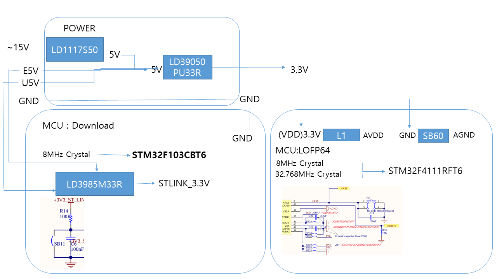
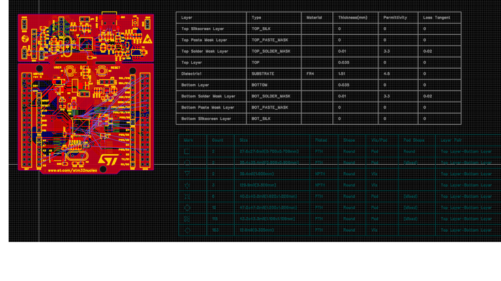

# STM32F4111_Project

pwd

# H1 제목
## H2 제목  
### H3 제목
#### H4 제목
##### H5 제목
###### H6 제목

*이탤릭체* 또는 _이탤릭체_

**볼드체** 또는 __볼드체__

***볼드 이탤릭*** 또는 ___볼드 이탤릭___

~~취소선~~

`인라인 코드`


항목 1
- 항목 2
  - 하위 항목 1
  - 하위 항목 2
    - 더 깊은 하위 항목


1. 첫 번째 항목
2. 두 번째 항목
   1. 하위 항목 1
   2. 하위 항목 2
3. 세 번째 항목


링크
[링크 텍스트](https://naver.com)

(https://naver.com)

인라인 코드. 자바일시
`javascript
function hello() {
    console.log('Hello World');
}
```
```python
def hello():
    print("Hello World")
```
```bash
npm install package-name
```


| 열1 | 열2 | 열3 |
|-----|-----|-----|
| 데이터1 | 데이터2 | 데이터3 |
| 데이터4 | 데이터5 | 데이터6 |

콜론 넣은 쪽으로 정렬됨. 양쪽에 넣을시 중앙
| 왼쪽 정렬 | 중앙 정렬 | 오른쪽 정렬 |
|:----------|:---------:|-----------:|
| 데이터1   |  데이터2  |     데이터3 |


인용문시 꺾쇠쓰기

이것은 인용문입니다.
> 여러 줄의 인용문도 가능합니다.
>
> > 중첩된 인용문

뺴기 3번 쓰면 선 생김
---


수식
$E = mc^2$ (인라인)

$$
\sum_{i=1}^{n} x_i = x_1 + x_2 + ... + x_n
$$


이미지 가져오기  br은 넘기기?라는데 뭔 소리인지 모르겠음. QR만들어서 설명?
##Hardware
<br>
<br>

이미지 폭 변경
<p align="center">
  
</p>

<p align="center">
  
</p>

<p align="center">
  
</p>

<p align="center">
  
</p>

<p align="center">
  
</p>

예시
<p align="center">
  
</p>

<p align="center">
  
</p>

<p align="center">
  
</p>

<p align="center">
  
</p>

<p align="center">
  
</p>
